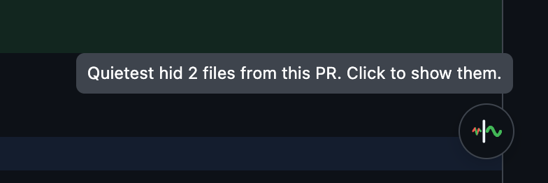
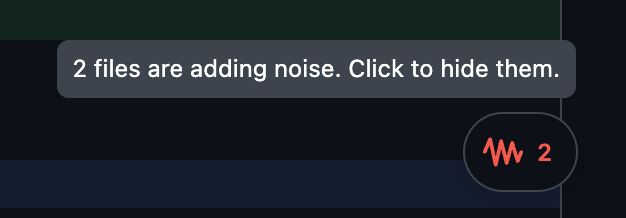
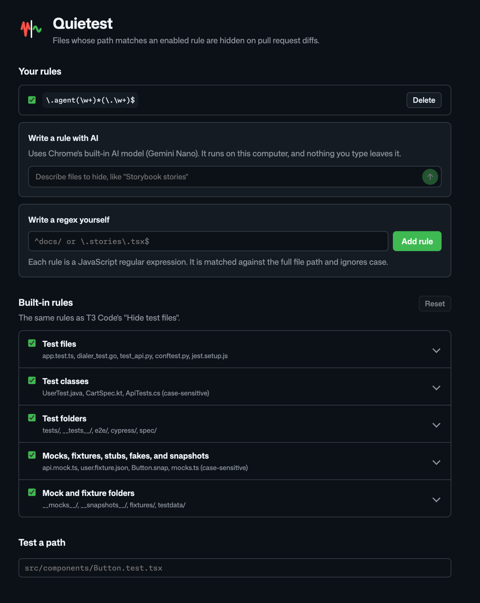
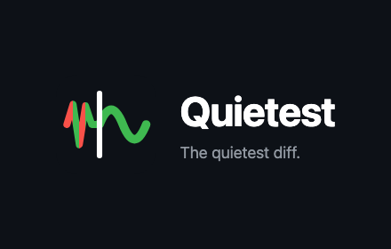
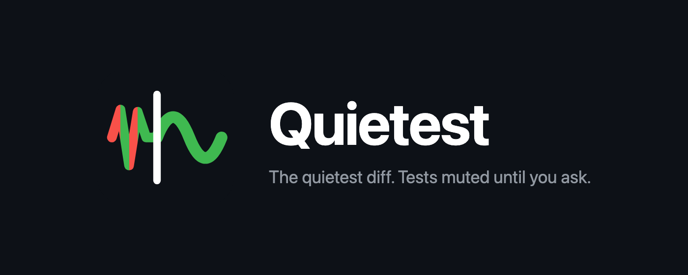

# Quietest 🤫

A Chrome extension that hides test files on GitHub pull requests, so you can review the real code. _The quietest diff: tests muted until you ask._

| Tests hidden (default) | Tests shown |
|---|---|
|  |  |

## Motivation 🤔

Since AI coding tools, pull requests got big. Much of each diff is tests, mocks, fixtures, and snapshots, and that noise buries the code you actually need to review. Quietest hides it, so you can review in peace.

It uses the same filter as T3 Code's "Hide test files" (`classifyChangedFile` in `packages/shared/src/changedFileKind.ts`): files classified as `tests` or `mocks` are hidden. The filter might be changed later, but right now it's same as T3 Code's. One difference: generated files (lockfiles, `*.gen.ts`) inside test or fixture folders are hidden too.

## Installation 🚀

Coming soon to the Chrome Web Store.

### Install from the latest release 📦

[link-release]: https://github.com/aashutoshrathi/quietest/releases/latest 'Latest release'

[][link-release]

1. Download `quietest.zip` from the [latest release][link-release]
2. Unzip it somewhere you'll keep it. Chrome loads the extension from this folder every time it starts
3. Open Chrome and navigate to `chrome://extensions/`
4. Enable "Developer mode" by toggling the switch in the top right corner
5. Click "Load unpacked" and select the unzipped folder
6. Open a PR's **Files changed** tab. Test files are now hidden

## Features 🌟

- Hides test files, mocks, fixtures, and snapshots in a PR's diff and in its file tree. Folders that hold only hidden files are hidden too.
- When Quietest hides files on a PR, its button shows at the bottom right of the page. Hover it to see how many files it hid. Click it to show them again; the button then turns into red noise with the count of files. Click again to hide them.
- Every new PR starts with these files hidden.
- Choose which paths to hide on the settings page, with your own regex rules or with Chrome's on-device AI.

## Settings ⚙️

Click the Quietest icon in the Chrome toolbar. If you do not see it, pin it from the extensions (puzzle) menu. You can also open **Details > Extension options** in `chrome://extensions`.

- Turn each built-in rule on or off.
- Add your own rules. A rule is a JavaScript regex, matched against the full file path, ignoring case. For example, `\.stories\.tsx$` or `^docs/`.
- Type a file path in **Test a path** to see which rule hides it.
- Describe files in plain English, like "database migrations", in **Write a rule with AI** and click the arrow. Chrome's on-device AI (Gemini Nano) writes the regex for you to review. Nothing you type leaves your computer. The first use downloads the model. If your Chrome or computer cannot run it, the page says why and links to [Chrome's requirements](https://developer.chrome.com/docs/ai/get-started).

Settings sync with your Chrome profile, and open PR tabs update at once.

### Development 🛠️

1. Download or clone this repository to your local machine
2. Open Chrome and navigate to `chrome://extensions/`
3. Enable "Developer mode" by toggling the switch in the top right corner
4. Click "Load unpacked" and select the directory containing the extension files
5. The extension should now be installed and active

Run the tests with `npm test`.

#### Icons

Edit `icons/icon.svg`, then run `./scripts/build-icons.sh` to make all PNGs again. It needs Google Chrome.

- `icons/16.png`, `32.png`, `48.png`, `128.png`: extension icons (128 has the 16 px padding the Chrome Web Store asks for).
- `store/promo-small.png` (440x280) and `store/promo-marquee.png` (1400x560): Chrome Web Store promo tiles.

| Small promo tile | Marquee |
|---|---|
|  |  |

#### Releasing

1. Bump `version` in `manifest.json`
2. Publish a GitHub release tagged with the same version, like `v0.1.0`
3. The **Publish** workflow checks the version, runs the tests, uploads the build to the Chrome Web Store, and attaches `quietest.zip` to the release. To retry a failed publish, run the workflow by hand with the tag

The workflow runs in the `chrome-web-store` environment and needs:

- Variable `CWS_EXTENSION_ID`: the extension's Chrome Web Store ID
- Secrets `CWS_CLIENT_ID`, `CWS_CLIENT_SECRET`, `CWS_REFRESH_TOKEN`: Chrome Web Store API credentials
- Secret `CRX_PRIVATE_KEY`: signs the package for Verified CRX Uploads

#### Fonts

The settings page uses GitHub's [Mona Sans](https://github.com/github/mona-sans) and [Monaspace Neon](https://github.com/githubnext/monaspace), both under the SIL Open Font License. The font files in `options/fonts/` are the original, unmodified releases, with their licenses next to them.
