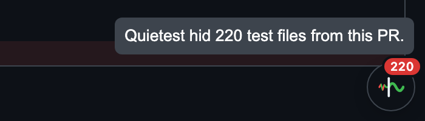
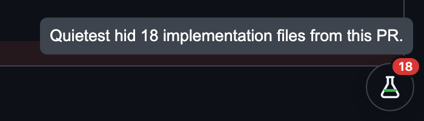
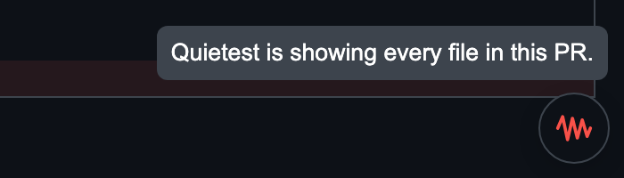
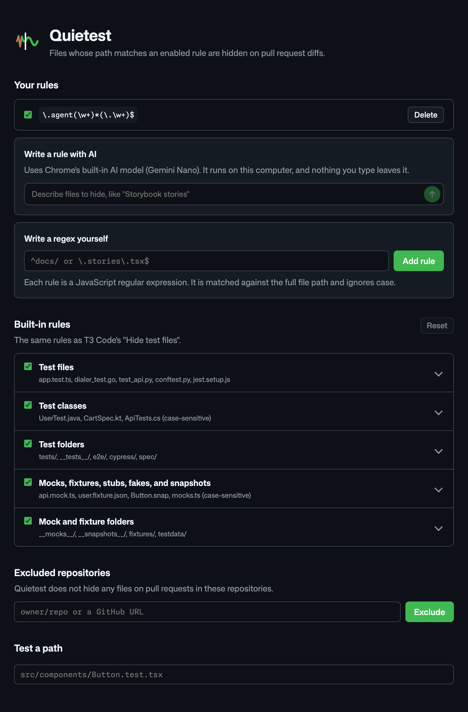
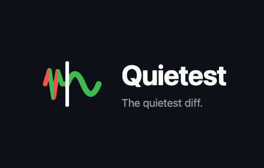
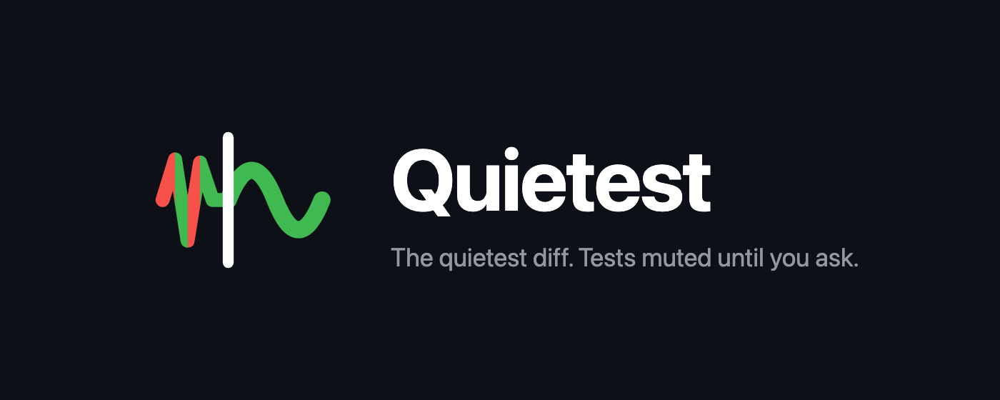

# Quietest 🤫

A Chrome extension that hides test files on GitHub pull requests, so you can review the real code. _The quietest diff: tests muted until you ask._

| Show implementation (default) | Show tests | Show both |
|---|---|---|
|  |  |  |

## Motivation 🤔

Since AI coding tools, pull requests got big. Much of each diff is tests, mocks, fixtures, and snapshots, and that noise buries the code you actually need to review. Quietest hides it, so you can review in peace.

It uses the same filter as T3 Code's "Hide test files" (`classifyChangedFile` in `packages/shared/src/changedFileKind.ts`): files classified as `tests` or `mocks` are hidden. The filter might be changed later, but right now it's same as T3 Code's. One difference: generated files (lockfiles, `*.gen.ts`) inside test or fixture folders are hidden too.

## Installation 🚀

[link-chrome]: https://chromewebstore.google.com/detail/jdnknkmpcknkhnelmoofpmdkjijkfmad 'Version published on Chrome Web Store'

[][link-chrome] [][link-chrome] and other Chromium browsers

### Install from the latest release 📦

[link-zip]: https://github.com/aashutoshrathi/quietest/releases/latest/download/quietest.zip 'Download the latest quietest.zip'

[][link-zip]

1. Download [`quietest.zip`][link-zip] and unzip it somewhere you'll keep it. Chrome loads the extension from this folder every time it starts
2. Open `chrome://extensions/` in a new tab and turn on **Developer mode** at the top right
3. Click **Load unpacked** and select the unzipped folder

Open a PR's **Files changed** tab. Test files are now hidden. This install does not update by itself, so download the ZIP again when a new release is out.

## Features 🌟

- Hides test files, mocks, fixtures, and snapshots in a PR's diff and in its file tree. Folders that hold only hidden files are hidden too.
- Works on a PR's **Files changed** tab and on individual commit diffs inside a PR.
- On a PR's diff, Quietest's button shows at the bottom right of the page with a badge for the hidden file count. Hover it to see how many files it hid.
- Click the button to open the view menu and switch between **Show implementation** (hides test files, the default), **Show tests** (hides implementation files so you can review tests on their own), and **Show both** (shows every file).
- Every new PR starts with test files hidden.
- Click **Open true diff** in the menu to see the PR as a structural, [difftastic](https://github.com/Wilfred/difftastic)-style diff. See [True diff](#true-diff-).
- Choose which paths to hide on the settings page, with your own regex rules or with Chrome's on-device AI, or exclude repositories you want Quietest to leave alone.

## True diff 🔍

GitHub compares lines, so reindenting a block, wrapping a long call, or joining two lines shows up as a wall of red and green. The true diff compares tokens (words, numbers, strings, and punctuation) and ignores whitespace and line breaks, the way [difftastic](https://github.com/Wilfred/difftastic) does.

- Changed tokens are highlighted. Lines GitHub marks changed that only moved whitespace or line breaks are muted.
- Files whose whole change is formatting are labeled **Formatting only** and hidden by default. Untick **Hide formatting-only files** to see them.
- It follows the current view: **Show implementation** leaves out test files, **Show tests** shows only test files, and **Show both** shows every file. Switching the view updates the true diff.
- Click a file name to jump to that file in GitHub's diff. Press Esc to close.
- It runs in your browser. Quietest fetches the PR's `.diff` from GitHub with your GitHub session and sends it nowhere else.

### Mute formatting changes in GitHub's diff

- Click **Mute formatting changes** in the Quietest menu. Lines that only moved whitespace or line breaks turn grey in GitHub's own diff, and files whose whole change is formatting get a **Formatting only** label. Real changes keep GitHub's colors.
- It applies to the PR you have open. To start every PR muted, turn on **Mute formatting changes on every PR** on the settings page.
- It works in GitHub's new and classic **Files changed** views, and on commit pages inside a PR.
- The first time you open a PR after you update, Quietest shows a short tip by its button. Click **Turn on** to mute every PR, or **Not now**. It does not show again.

The true diff works on the diff GitHub serves, so it compares the changed hunks, not whole files. It uses a tokenizer that works for any language, not difftastic's per-language parsers, so it doesn't understand syntax: a change that moves code between hunks shows as a deletion and an addition. Very large hunks fall back to GitHub's line diff, and PRs whose diff is over 20 MB show a message instead.

## Settings ⚙️

Click the Quietest icon in the Chrome toolbar. If you do not see it, pin it from the extensions (puzzle) menu. You can also open **Details > Extension options** in `chrome://extensions`.

- Turn each built-in rule on or off.
- Add your own rules. A rule is a JavaScript regex, matched against the full file path, ignoring case. For example, `\.stories\.tsx$` or `^docs/`. A regex that is too slow to run safely on GitHub pages is rejected.
- Type a file path in **Test a path** to see which rule hides it.
- Add a repository to **Excluded repositories** (`owner/repo` or its GitHub URL) and Quietest leaves its pull requests alone.
- Describe files in plain English, like "database migrations", in **Write a rule with AI** and click the arrow. Chrome's on-device AI (Gemini Nano) writes the regex for you to review. Nothing you type leaves your computer. The first use downloads the model. If your Chrome or computer cannot run it, the page says why and links to [Chrome's requirements](https://developer.chrome.com/docs/ai/get-started).

Settings sync with your Chrome profile, and open PR tabs update at once.

## Privacy 🔒

Quietest does not collect or send any data. Your rules stay in your browser. The true diff fetches the PR's diff from GitHub and computes everything locally. See the [privacy policy](privacy-policy.html).

### Development 🛠️

1. Download or clone this repository to your local machine
2. Run `npm run build`. It copies the extension files into `dist/`. Chrome can't load the repository root, because the site's `_includes` folder starts with `_`
3. Open Chrome and navigate to `chrome://extensions/`
4. Enable "Developer mode" by toggling the switch in the top right corner
5. Click "Load unpacked" and select the `dist` folder
6. After a change, run `npm run build` again and click reload on the Quietest card

Run the tests with `npm test`.

#### Icons

Edit `icons/icon.svg`, then run `./scripts/build-icons.sh` to make all PNGs again. It needs Google Chrome.

- `icons/16.png`, `32.png`, `48.png`, `128.png`: extension icons (128 has the 16 px padding the Chrome Web Store asks for).
- `store/promo-small.png` (440x280) and `store/promo-marquee.png` (1400x560): Chrome Web Store promo tiles.
- `docs/og.png` (1200x630): link preview image for the website. It uses the screenshots in `docs/`, so build again after you change them.

| Small promo tile | Marquee |
|---|---|
|  |  |

#### Releasing

1. Bump `version` in `manifest.json`
2. Publish a GitHub release tagged with the same version, like `v0.1.0`
3. The **Publish** workflow checks the version, runs the tests, attaches `quietest.zip` to the release, and then uploads the same ZIP to the Chrome Web Store. The ZIP stays on the release even if the store upload fails. To retry a failed publish, run the workflow by hand with the tag

The store upload runs in the `chrome-web-store` environment and needs:

- Variable `CWS_EXTENSION_ID`: the extension's Chrome Web Store ID
- Secrets `CWS_CLIENT_ID`, `CWS_CLIENT_SECRET`, `CWS_REFRESH_TOKEN`: Chrome Web Store API credentials
- Secret `CRX_PRIVATE_KEY`: signs the package for Verified CRX Uploads

#### Fonts

The settings page uses GitHub's [Mona Sans](https://github.com/github/mona-sans) and [Monaspace Neon](https://github.com/githubnext/monaspace), both under the SIL Open Font License. The font files in `options/fonts/` are the original, unmodified releases, with their licenses next to them.
